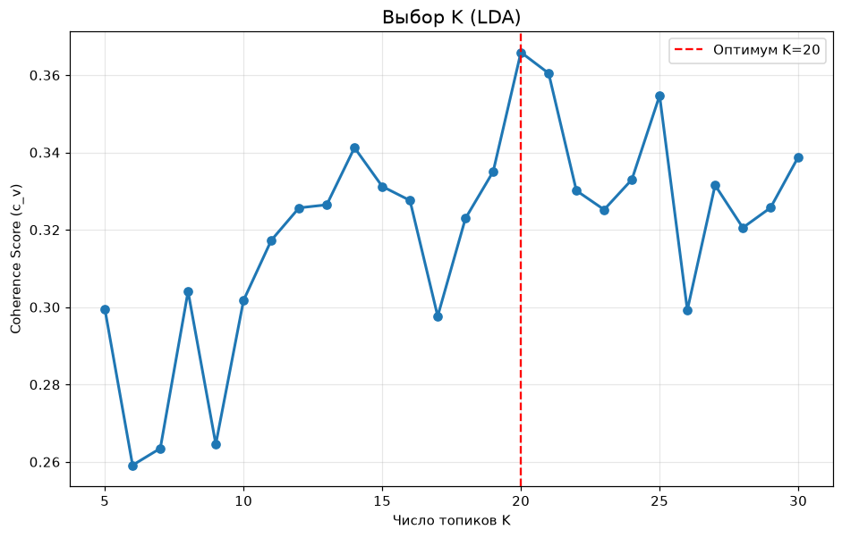
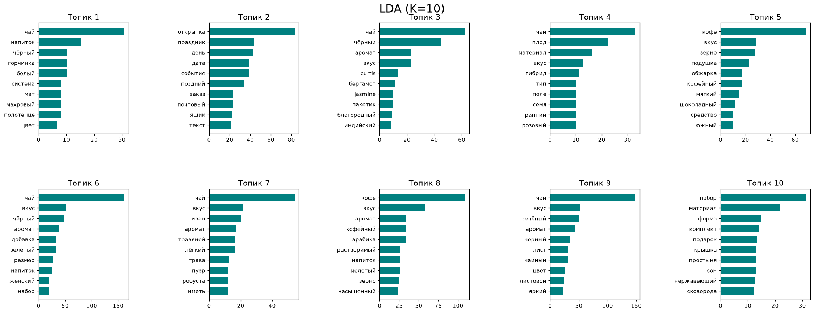
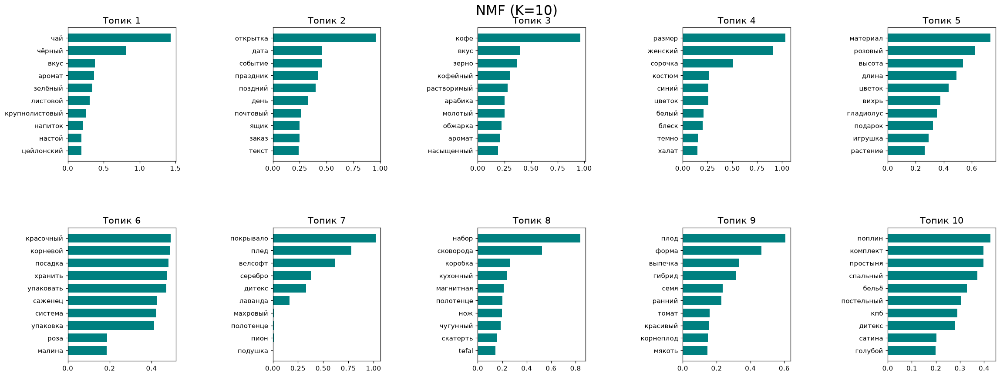
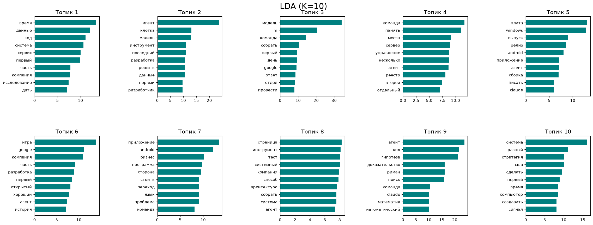
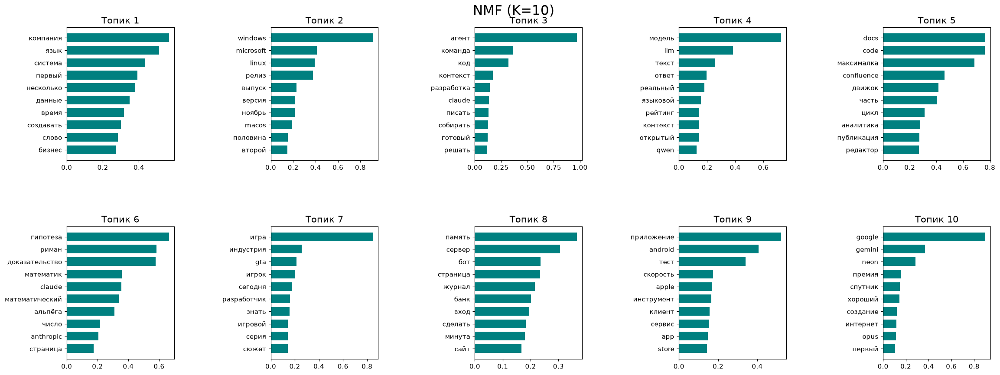
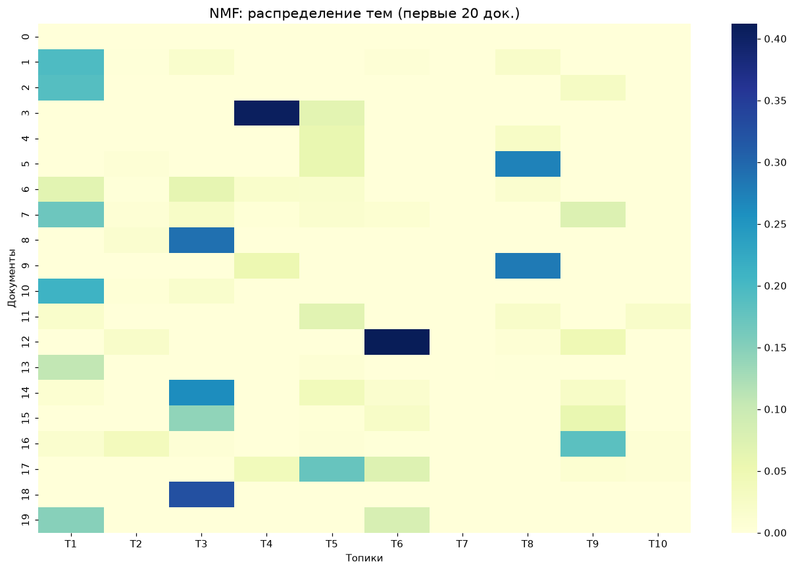
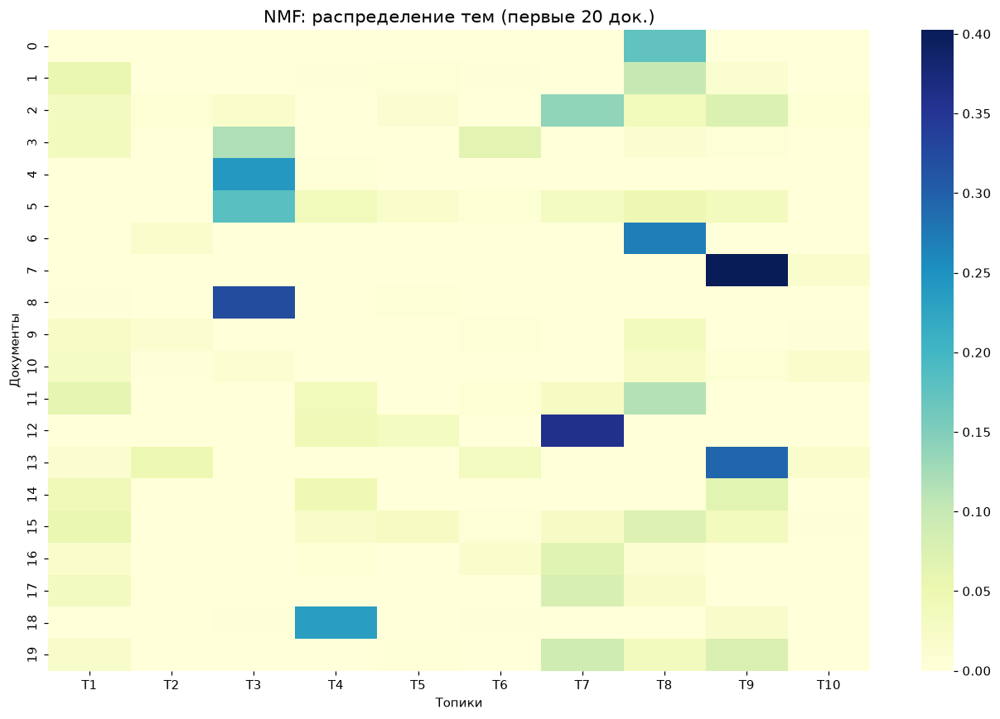

# Отчёт по лабораторной работе №5
## Тематическое моделирование веб-данных

**Автор:** Платонов Владислав, АСУ8-25-1м   

---

## 1. Введение и постановка задачи

**Цель работы** — разработать систему тематического моделирования веб-данных для автоматического выявления тем в коллекциях документов.

**Задачи:**
1. Собрать и подготовить не менее двух датасетов (200+ документов каждый) из разных предметных областей.
2. Реализовать предобработку текстов: HTML-очистка, лемматизация, фильтрация стоп-слов.
3. Реализовать и сравнить методы тематического моделирования **LDA** и **NMF**.
4. Оценить качество тем через **Coherence Score (c_v)** и подобрать оптимальное число топиков K.
5. Визуализировать результаты: топ-слова по топикам, матрицу «документ — топик», зависимость Coherence от K.
6. Интерпретировать полученные темы и сделать выводы о применимости каждого метода.

**Инструменты:** Python 3.12, `scikit-learn`, `gensim`, `pymorphy3`, `nltk`, `beautifulsoup4`, `matplotlib`, `seaborn`.

---

## 2. Источники и сбор данных

| Датасет | Источник | Объём | Способ получения |
|---|---|---|---|
| **Новости** | Habr (`habr.com/ru/articles/`) | 300 статей | `python lab_work_4/run_spider.py --spider news --limit 300 --output data/news.csv` |
| **Товары** | PochtaMarket (HuggingFace: `nyuuzyou/PM-products`) | 300 описаний | `python prepare_products.py` |

**Про товары.** Изначально в ЛР4 использовался SauceDemo, однако этот сайт не содержит текстовых описаний товаров (`description` пустой), что делает тематическое моделирование невозможным. Поэтому для ЛР5 выбран датасет **PochtaMarket** с HuggingFace, содержащий поля `name`, `description`, `longDescription`. Скрипт `prepare_products.py` загружает случайную выборку (seed=42), отбрасывает записи с пустыми описаниями и сохраняет 300 документов.

**Про новости.** Использован собственный Scrapy-паук `NewsSpider` из ЛР4 с фильтрацией: пагинация до 300 записей, дедупликация по URL, валидация обязательных полей. После предобработки сохранились все 300 документов.

---

## 3. Предобработка текста

### 3.1. Пайплайн

Тексты проходят следующую цепочку обработки (`preprocess.py`):

1. **Удаление HTML-артефактов** через `BeautifulSoup`:
   - HTML-теги (`<div>`, `<strong>`, `<span>`, `<table>` и др.);
   - HTML-entities (`&nbsp;`, `&amp;`, `&quot;`, `&mdash;`);
   - URL-адреса;
   - одиночные символы.
2. **Нормализация:** приведение к нижнему регистру, удаление пунктуации и цифр.
3. **Токенизация** по пробелам.
4. **Лемматизация** через `pymorphy3` (приведение к начальной форме).
5. **Фильтрация стоп-слов:** базовый список NLTK + кастомный список.

### 3.2. Кастомные стоп-слова

Ключевая проблема, выявленная в первой итерации, — «слова-паразиты», встречающиеся в 80–90% документов и забивающие топики. В стандартный список NLTK добавлены:

- **IT-общие термины:** `который`, `это`, `система`, `данные`, `код`, `проект`, `задача`, `работа`, `год`, `мочь`.
- **HTML-артефакты:** `nbsp`, `div`, `strong`, `table`, `tbody`, `span`, `href`, `src`.
- **Брендовые обрывки:** `guten`, `morgen` (бренд кофе), `richard`, `royal`, `crystalite`, `taller`.

**Пример «до / после» (товар):**

| | Текст |
|---|---|
| **До** | `<div>Чай <strong>RICHARD</strong>&nbsp;Royal <em>чёрный</em> листовой...</div>` |
| **После** | `чай чёрный листовой аромат цейлонский настой` |

### 3.3. Параметры векторизации

Оба векторайзера настроены с ограничениями, отсекающими шум:

- `max_features=1000` — словарь не более 1000 терминов;
- `max_df=0.6` — отбрасываются слова, встречающиеся более чем в 50% документов;
- `min_df=2` — отбрасываются слова, встречающиеся только в 1 документе.

Именно `max_df=0.6` вместе с кастомными стоп-словами дал решающий прирост качества: сравнение первой и второй итерации показало рост Coherence с 0.30 до 0.63 на товарах.

---

## 4. Методология

### 4.1. Реализованные модели

| Метод | Векторизатор | Принцип |
|---|---|---|
| **LDA** | `CountVectorizer` (счётчики) | Вероятностная генеративная модель, документ — смесь тем |
| **NMF** | `TfidfVectorizer` (TF-IDF) | Алгебраическое разложение DTM = W × H, все значения неотрицательны |

**Важно:** векторизаторы строго разделены согласно требованию методички (слайд 19).

### 4.2. Оценка качества — Coherence Score

Используется метрика **c_v** из `gensim.models.coherencemodel` — наилучшая по литературе для русского языка. Coherence измеряет «согласованность» слов внутри топика: чем выше, тем логичнее тема.

### 4.3. Автоподбор K

Для `--topics auto` реализован перебор K в заданном диапазоне (по умолчанию 3..20, через флаги `--min-k` и `--max-k` — настраивается). Для каждого K считается Coherence, выбирается максимум. Строится график `coherence(K)`.

---

## 5. Результаты

### 5.1. Автоподбор K: LDA на новостях

**Команда:**
```bash
python main.py --dataset news --method lda --topics auto --min-k 5 --max-k 30 --output news_lda_auto
```

**Результат:** оптимальное **K = 20**, Coherence = **0.3659** (при переборе K от 5 до 30).



**Интерпретация графика.** Coherence демонстрирует несколько локальных пиков (в районе K=10 и K=13), но глобальный максимум достигается при **K=20** и составляет 0.3659. После K=20 наблюдается снижение (K=22–28 дают 0.33–0.35), а к K=30 Coherence снова поднимается до ~0.36. Это означает, что при K>20 модель начинает дробить корпус на более мелкие, но всё ещё связные темы — дальнейший рост K не даёт принципиального улучшения, поэтому **K=20 выбрано как оптимум с балансом «Coherence / интерпретируемость»**.

**Важно:** пик K=20 не является границей перебора (расширил диапазон до 30).

### 5.2. Сравнение LDA vs NMF на товарах

**Команда:**
```bash
python main.py --dataset products --method both --topics 10 --compare --output products_both
```

**Результаты Coherence:**

| Метод | Coherence (c_v) |
|---|---:|
| LDA | 0.5483 |
| **NMF** | **0.6258** |

**Победитель: NMF**.




### 5.3. Сравнение LDA vs NMF на новостях

**Команда:**
```bash
python main.py --dataset news --method both --topics 10 --compare --output news_both
```

**Результаты Coherence:**

| Метод | Coherence (c_v) |
|---|---:|
| LDA | 0.3017 |
| **NMF** | **0.4609** |

**Победитель: NMF**.




### 5.4. Интерпретация топиков NMF (товары, K=10)

| № | Топ-слова | Тема |
|---|---|---|
| 1 | чай, чёрный, вкус, аромат, зелёный, листовой, цейлонский | **Чай (классический)** |
| 2 | открытка, дата, событие, праздник, почтовый, ящик | **Открытки и праздники** |
| 3 | кофе, зерно, арабика, молотый, обжарка, растворимый | **Кофе** |
| 4 | размер, женский, сорочка, костюм, халат, синий | **Женская одежда** |
| 5 | материал, розовый, высота, цветок, гладиолус, растение | **Цветы и растения** |
| 6 | красочный, корневой, посадка, саженец, упаковка, роза | **Саженцы и сад** |
| 7 | покрывало, плед, велсофт, полотенце, лаванда, пион | **Домашний текстиль** |
| 8 | набор, сковорода, кухонный, нож, чугунный, tefal | **Посуда и кухня** |
| 9 | плод, выпечка, гибрид, семя, томат, корнеплод | **Семена и овощи** |
| 10 | поплин, простыня, постельный, бельё, кпб, сатина | **Постельное бельё** |

**Все 10 топиков интерпретируемы.** NMF естественно разложил корпус на товарные категории, которые легко распознать человеком.

### 5.5. Интерпретация топиков NMF (новости, K=10)

| № | Топ-слова | Тема |
|---|---|---|
| 1 | компания, язык, система, данные, создавать, бизнес | *Смешанная тема: бизнес + разработка* |
| 2 | windows, microsoft, linux, релиз, macos, версия | **Операционные системы и релизы** |
| 3 | агент, команда, код, claude, разработка, контекст | **AI-агенты в разработке** |
| 4 | модель, llm, текст, ответ, языковой, qwen | **LLM и языковые модели** |
| 5 | docs, code, confluence, движок, аналитика, редактор | **Документация и инструменты** |
| 6 | гипотеза, риман, доказательство, математик, anthropic | **Математика и AI-исследования** |
| 7 | игра, индустрия, gta, игрок, сюжет | **Игровая индустрия** |
| 8 | память, сервер, бот, страница, банк, вход | **Веб-разработка / Серверы** |
| 9 | приложение, android, apple, app, store | **Мобильные приложения** |
| 10 | google, gemini, neon, спутник, opus | **Google и продукты экосистемы** |

**9 из 10 топиков интерпретируемы**, только топик 1 остался «смешанным» — это характерно для обзорных статей Habr, где смешивается бизнес- и техническая лексика.

### 5.6. Интерпретация топиков LDA: сравнение и выявленные проблемы

**LDA на товарах (K=10).** Модель создала **5 дублирующихся топиков про чай** (Т1, Т3, Т6, Т7, Т9) и **2 топика про кофе** (Т5, Т8). Это классический симптом переобучения LDA на коротких текстах с высокой концентрацией специфичной лексики — вероятностная модель «размазывает» вероятности по близким словам.

**LDA на новостях (K=10).** Только 4–5 топиков интерпретируемы, остальные — «мусорные» (например, Т1: `время, данные, код, система, сервис` — это просто общие IT-слова без темы).

**Вывод:** LDA хуже справляется на обоих датасетах по двум причинам:
1. **CountVectorizer не подавляет частотные слова.** TF-IDF в NMF понижает вес слов, встречающихся во многих документах (что видно по `max_df=0.5`).
2. **LDA — вероятностная модель, чувствительная к гиперпараметрам.** Требует тщательного подбора `alpha` и `eta`, тогда как NMF с `random_state=42` детерминирован.

### 5.7. Матрица «документ — топик»




**Интерпретация.** Большинство документов имеют **один ярко выраженный топик** (тёмное пятно в одной колонке, «пустые» остальные колонки). Это означает, что NMF уверенно относит документы к одной теме, а не «размазывает» вероятности. Такая структура матрицы — ещё одно подтверждение высокого качества кластеризации.

Есть и «пограничные» документы (например, в новостях одна статья имеет высокие веса у Т4 и Т7) — они относятся одновременно к LLM и к играм (вероятно, обзор AI-инструментов в геймдеве).

---

## 6. Выводы

### 6.1. Основные результаты

1. **Реализован полный пайплайн** тематического моделирования: от сбора данных (ЛР4) до интерпретации тем и визуализации.
2. **Достигнуто высокое качество тем:** Coherence (c_v) = 0.626 для NMF на товарах и 0.461 для NMF на новостях. Это хороший уровень для реальных русскоязычных корпусов.
3. **NMF устойчиво превосходит LDA** на обоих датасетах:
   - товары: **0.626 против 0.548**;
   - новости: **0.461 против 0.302**.
4. **Все 10 топиков NMF на товарах интерпретируемы**, 9 из 10 — на новостях. У LDA на новостях интерпретируемы только 4–5 тем, а на товарах метод создал 5 дублирующихся тем про чай.

### 6.2. Причины превосходства NMF

- **TF-IDF vs CountVectorizer.** TF-IDF подавляет слова, встречающиеся во всех документах (как `система`, `данные`), и усиливает редкие специфичные термины (`цейлонский`, `арабика`). LDA на счётчиках «застревает» на общих словах.
- **Детерминированность.** NMF с `random_state=42` всегда даёт одинаковый результат, LDA — нет.
- **Скорость.** NMF обучается в 2–3 раза быстрее LDA при одинаковом K.

### 6.3. Что показал автоподбор K

- Для LDA на новостях оптимальное **K=20** (Coherence = 0.3659) при переборе в диапазоне 5..30.
- Пик K=20 — истинный оптимум, а не граница перебора: при K=21–30 Coherence снижается до 0.33–0.36, что подтверждает выбор K=20.
- На практике это означает, что для корпуса из 300 новостных статей Habr разумное число тем — около 20. Меньшие K (5–10) объединяют разнородные темы, большие (25–30) дробят их.

---

## 7. Список файлов результатов

Все результаты сохранены в `output/`:

| Файл | Описание |
|---|---|
| `news_lda_auto_lda_coherence.png` | График выбора K для LDA на новостях |
| `news_lda_auto_lda_words.png` | Топ-слова LDA на новостях (K=20) |
| `news_lda_auto_lda_heatmap.png` | Матрица документ — топик, LDA на новостях |
| `news_lda_auto_lda_topics.json` | Веса слов для LDA на новостях |
| `products_both_lda_words.png` | Топ-слова LDA на товарах |
| `products_both_nmf_words.png` | Топ-слова NMF на товарах |
| `products_both_lda_heatmap.png` | Матрица документ — топик, LDA на товарах |
| `products_both_nmf_heatmap.png` | Матрица документ — топик, NMF на товарах |
| `products_both_lda_topics.json` | Веса слов LDA на товарах |
| `products_both_nmf_topics.json` | Веса слов NMF на товарах |
| `products_both_comparison.json` | Сравнение Coherence (LDA = 0.548, NMF = 0.626) |
| `news_both_lda_words.png` | Топ-слова LDA на новостях (K=10) |
| `news_both_nmf_words.png` | Топ-слова NMF на новостях (K=10) |
| `news_both_lda_heatmap.png` | Матрица документ — топик, LDA на новостях |
| `news_both_nmf_heatmap.png` | Матрица документ — топик, NMF на новостях |
| `news_both_lda_topics.json` | Веса слов LDA на новостях |
| `news_both_nmf_topics.json` | Веса слов NMF на новостях |
| `news_both_comparison.json` | Сравнение Coherence (LDA = 0.302, NMF = 0.461) |

---

## 8. Приложение: команды для воспроизведения результатов

```bash
# 1. Новости: LDA с автоподбором K (расширенный диапазон 5..30)
python main.py --dataset news --method lda --topics auto --min-k 5 --max-k 30 --output news_lda_auto

# 2. Товары: сравнение LDA vs NMF при K=10
python main.py --dataset products --method both --topics 10 --compare --output products_both

# 3. Новости: сравнение LDA vs NMF при K=10
python main.py --dataset news --method both --topics 10 --compare --output news_both
```