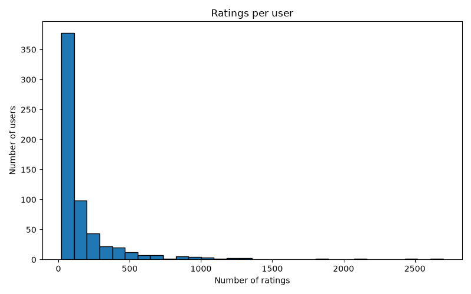
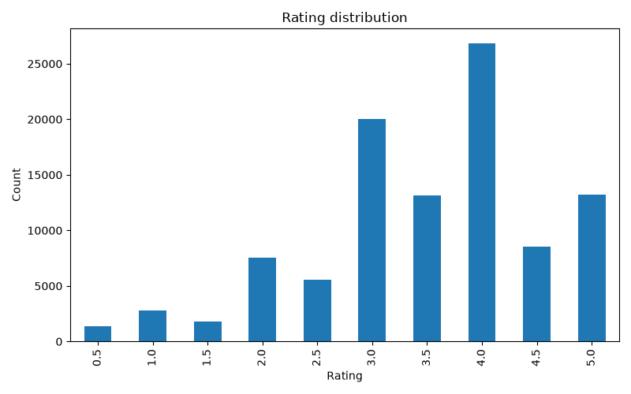
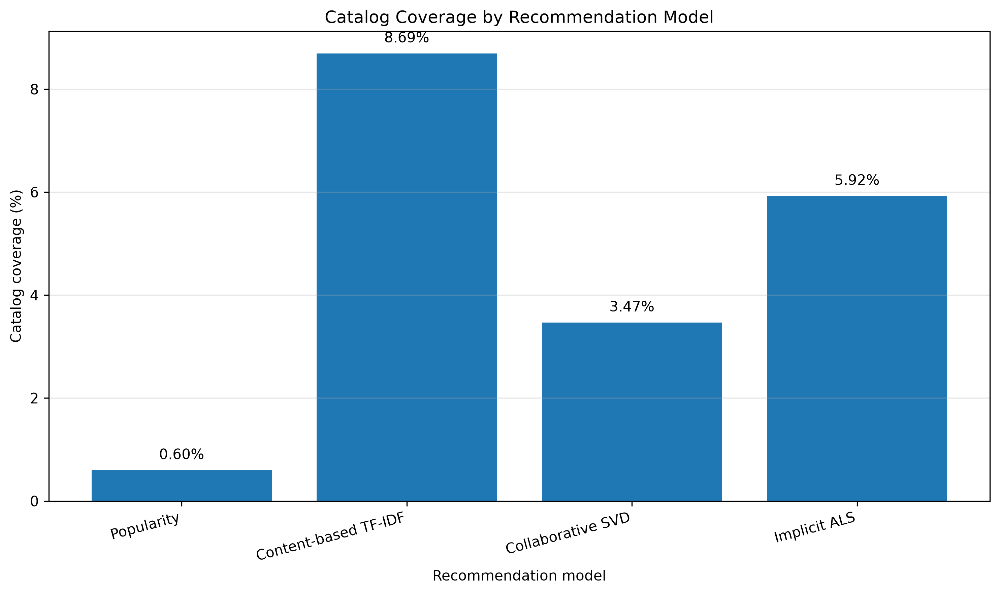

# Лабораторная работа №7. Отчет на тему "Рекомендательная система для медиакаталога"

**Автор:** Платонов Владислав, АСУ8-25-1м

## 1. Введение

**Цель работы** — разработать рекомендательную систему для медиакаталога, реализовать несколько подходов к формированию персональных рекомендаций и сравнить их качество с базовой моделью популярности.

Для достижения цели были поставлены следующие задачи:

1. Выбрать набор данных и обосновать его пригодность для построения рекомендательной системы.
2. Провести исследовательский анализ данных (EDA).
3. Подготовить обучающую и тестовую выборки.
4. Реализовать контентную модель на основе TF-IDF.
5. Реализовать коллаборативные модели SVD и ALS.
6. Разработать базовую модель рекомендаций по популярности.
7. Оценить качество рекомендаций с помощью Precision@K, Recall@K, MAP@K и NDCG@K.
8. Исследовать покрытие каталога и разнообразие рекомендательной выдачи.
9. Проанализировать примеры персональных рекомендаций и возможное возникновение фильтрующего пузыря.

В качестве результата разработан программный проект на Python с единым интерфейсом командной строки (CLI), позволяющим запускать анализ данных, обучение моделей, генерацию рекомендаций и оценку качества.

## 2. Выбор и описание набора данных

Для разработки рекомендательной системы был выбран набор данных **MovieLens Latest Small**, опубликованный на платформе Hugging Face в репозитории `ashraq/ml-latest-small`.

Источник данных: https://huggingface.co/datasets/ashraq/ml-latest-small

MovieLens содержит информацию о фильмах, их жанрах и пользовательских оценках. Выбор данного набора обусловлен следующими факторами:

- наличие реальных пользовательских взаимодействий с медиаконтентом;
- наличие явной обратной связи в виде оценок по шкале от 0.5 до 5.0;
- достаточное количество пользователей, фильмов и взаимодействий для проведения экспериментов;
- возможность применения алгоритмов коллаборативной фильтрации, в частности SVD из библиотеки Surprise;
- наличие названий и жанров фильмов, позволяющих построить контентную модель.

В рамках работы использовались два основных файла:

- `ratings.csv` — пользовательские оценки фильмов;
- `movies.csv` — идентификаторы, названия и жанры фильмов.

Основные характеристики набора данных:

| Характеристика | Значение |
|---|---:|
| Количество пользователей | 610 |
| Количество фильмов | 9 724 |
| Количество оценок | 100 836 |
| Минимальная оценка | 0.5 |
| Максимальная оценка | 5.0 |

Набор данных содержит явные оценки, однако для эксперимента с ALS они дополнительно преобразуются в неявную обратную связь: взаимодействия с оценкой 4.0 и выше рассматриваются как положительные.

Таким образом, выбранный датасет позволяет исследовать как контентный подход, так и несколько вариантов коллаборативной фильтрации.

При этом у MovieLens есть ограничения: набор относительно небольшой по сравнению с промышленными медиакаталогами, а отсутствие временных меток в использованной версии не позволяет провести временное разделение данных и оценить динамику пользовательских предпочтений.

## 3. Исследовательский анализ данных (EDA)

На первом этапе был проведён исследовательский анализ данных для определения структуры набора, проверки качества данных и изучения активности пользователей.

### 3.1. Общая характеристика

После загрузки и объединения данных были получены следующие показатели:

| Показатель | Значение |
|---|---:|
| Количество оценок | 100 836 |
| Количество пользователей | 610 |
| Количество фильмов | 9 724 |
| Размер матрицы взаимодействий | 610 × 9 724 |
| Среднее количество оценок на пользователя | 165.30 |
| Среднее количество оценок на фильм | 10.37 |

Проверка качества данных показала отсутствие пропущенных значений и дубликатов по парам `userId` и `movieId`.

### 3.2. Разреженность матрицы взаимодействий

Для анализа взаимодействий была сформирована матрица пользователей и фильмов размером 610 × 9 724.

Общее количество возможных пар «пользователь — фильм»:

\[
610 \times 9724 = 5\,931\,640
\]

Фактически в наборе содержится 100 836 оценённых пар.

Плотность матрицы:

\[
Density = \frac{100836}{610 \times 9724}
\approx 0.017
\]

Разреженность:

\[
Sparsity = 1 - Density \approx 0.983
\]

Таким образом:

- плотность матрицы — **1.70%**;
- разреженность матрицы — **98.30%**.

Высокая разреженность является характерной особенностью рекомендательных систем: каждый пользователь взаимодействует лишь с небольшой частью доступного каталога. Это делает задачу восстановления предпочтений по ограниченному количеству оценок нетривиальной.

### 3.3. Активность пользователей

Количество оценок, оставленных разными пользователями, существенно различается.

| Статистика | Количество оценок |
|---|---:|
| Минимум | 20 |
| Первый квартиль (Q1) | 35 |
| Медиана | 70.5 |
| Третий квартиль (Q3) | 168 |
| Максимум | 2 698 |
| Среднее | 165.30 |
| Стандартное отклонение | 269.48 |

*Рисунок 1 — Распределение активности пользователей.*

Распределение активности пользователей неоднородно: большинство пользователей оставили относительно небольшое количество оценок, тогда как небольшая группа пользователей обладает значительно более длинной историей взаимодействий.

Это обстоятельство важно учитывать при оценке рекомендательных моделей. Пользователи с большим количеством оценок предоставляют больше информации для построения персонального профиля, чем пользователи с короткой историей.

### 3.4. Активность фильмов

Количество оценок на один фильм также распределено неравномерно.

| Статистика | Количество оценок |
|---|---:|
| Минимум | 1 |
| Первый квартиль (Q1) | 1 |
| Медиана | 3 |
| Третий квартиль (Q3) | 9 |
| Максимум | 329 |
| Среднее | 10.37 |
| Стандартное отклонение | 22.40 |

Большинство фильмов имеют небольшое количество оценок. При этом отдельные фильмы значительно популярнее остальных.

Такое распределение создаёт предпосылки для смещения рекомендаций в сторону наиболее популярных объектов и делает важным дополнительный анализ покрытия каталога.

### 3.5. Распределение оценок

Наиболее часто пользователи выставляли оценки 3.0 и 4.0. Наибольшее количество оценок приходится на значение 4.0 — 26 818 оценок.

| Оценка | Количество |
|---:|---:|
| 0.5 | 1 370 |
| 1.0 | 2 811 |
| 1.5 | 1 791 |
| 2.0 | 7 551 |
| 2.5 | 5 550 |
| 3.0 | 20 047 |
| 3.5 | 13 136 |
| 4.0 | 26 818 |
| 4.5 | 8 551 |
| 5.0 | 13 211 |

*Рисунок 2 — Распределение пользовательских оценок.*

В целом в данных преобладают положительные оценки. Это необходимо учитывать при определении релевантных объектов для последующей оценки качества рекомендаций.

По результатам EDA были сформированы графики распределения активности пользователей и распределения оценок. Они сохранены в каталоге `results/figures/`.

## 4. Подготовка данных и протокол эксперимента

После завершения EDA данные были подготовлены для обучения и оценки рекомендательных моделей.

### 4.1. Разделение на обучающую и тестовую выборки

Поскольку в использованной версии датасета отсутствуют временные метки, применить временное разделение взаимодействий невозможно.

Вместо этого было выполнено случайное разбиение отдельно для каждого пользователя:

- 80% взаимодействий — обучающая выборка (`train.csv`);
- 20% взаимодействий — тестовая выборка (`test.csv`).

Для воспроизводимости эксперимента использовалось фиксированное значение `random_state = 42`.

Результат разделения:

| Показатель | Train | Test |
|---|---:|---:|
| Количество взаимодействий | 80 672 | 20 164 |
| Доля данных | 80% | 20% |
| Количество пользователей | 610 | 610 |

Для каждого пользователя взаимодействия были распределены между обучающей и тестовой выборками. Одна и та же пара «пользователь — фильм» не встречается одновременно в обеих частях.

### 4.2. Определение релевантных объектов

Для расчёта метрик ранжирования необходимо определить, какие фильмы считаются релевантными пользователю.

В данной работе положительным взаимодействием считается оценка **4.0 и выше**.

Это правило применяется к тестовой выборке при расчёте Precision@K, Recall@K, MAP@K и NDCG@K.

В тестовой выборке содержится 9 772 положительных взаимодействия.

Для оценки качества использовались 601 пользователь, у которых в тестовой выборке имеется хотя бы один положительно оценённый фильм.

### 4.3. Подготовка данных для моделей

Для разных алгоритмов используются различные представления взаимодействий:

- **Popularity:** обучающая выборка группируется по фильмам, после чего рассчитываются количество оценок и средний рейтинг.
- **Content-based TF-IDF:** названия и жанры фильмов объединяются в текстовое представление, на основе которого строятся TF-IDF-векторы.
- **SVD:** модель обучается на исходных пользовательских оценках в диапазоне от 0.5 до 5.0.
- **ALS:** исходные оценки преобразуются в неявные положительные взаимодействия с порогом 4.0. Веса положительных взаимодействий определяются на основе величины оценки.

При генерации рекомендаций из выдачи исключаются фильмы, которые пользователь уже оценил в обучающей выборке. Это позволяет не рекомендовать объекты, уже известные пользователю на момент формирования рекомендаций.

### 4.4. Параметры эксперимента

Основные параметры эксперимента задаются в файле `config/config.yaml`.

| Параметр | Значение |
|---|---:|
| Test size | 0.2 |
| Random state | 42 |
| Positive threshold | 4.0 |
| Top-K | 10 |

Для всех моделей при сравнении используется одинаковое значение K = 10 и одна и та же тестовая выборка.

Это позволяет сопоставлять результаты моделей в рамках единого экспериментального протокола.

## 5. Реализация рекомендательных моделей

В рамках эксперимента были реализованы четыре подхода к формированию рекомендаций: базовая модель популярности, контентная модель TF-IDF, коллаборативная фильтрация SVD и модель неявной коллаборативной фильтрации ALS.

Все модели формируют рекомендации длиной 10 фильмов для каждого пользователя. Фильмы, уже присутствующие в обучающей истории пользователя, исключаются из рекомендательной выдачи.

### 5.1. Базовая модель популярности (Popularity)

В качестве базовой модели используется ранжирование фильмов по популярности.

Для каждого фильма на обучающей выборке рассчитываются:

- количество пользовательских оценок;
- средняя оценка.

Фильмы сортируются сначала по количеству оценок в порядке убывания, затем по средней оценке. При равенстве этих показателей используется идентификатор фильма для стабильной сортировки.

Пользователю рекомендуются наиболее популярные фильмы, которые он ещё не оценивал в обучающей выборке.

Данная модель не учитывает индивидуальные предпочтения пользователей и служит базовой точкой сравнения для остальных алгоритмов.

### 5.2. Контентная модель TF-IDF

Контентная модель использует информацию о самих фильмах: названия и жанры.

На первом этапе название и жанры объединяются в текстовое описание. Затем с помощью `TfidfVectorizer` формируется векторное представление каждого фильма.

Для построения профиля пользователя используются фильмы из обучающей истории с оценкой 4.0 и выше. Векторы положительно оценённых фильмов объединяются в пользовательский профиль с весами, зависящими от величины оценки.

После этого вычисляется косинусное сходство между профилем пользователя и векторами фильмов каталога.

Фильмы ранжируются по убыванию сходства. Уже оценённые пользователем фильмы исключаются из результата.

Преимущество данного подхода заключается в возможности формировать рекомендации на основе характеристик объектов. Недостаток — зависимость от качества и полноты текстовых описаний. В данной реализации используются только названия и жанры, поэтому модель не учитывает сюжет, актёрский состав и другие дополнительные характеристики фильмов.

### 5.3. Коллаборативная фильтрация SVD

Для реализации коллаборативной фильтрации с явной обратной связью использована библиотека `scikit-surprise`.

В качестве алгоритма применяется матричная факторизация SVD. Модель обучается на исходных пользовательских оценках.

Суть подхода заключается в представлении пользователей и фильмов в общем латентном пространстве. На основе полученных векторов модель прогнозирует оценки фильмов, которые пользователь ещё не оценивал.

Использованные параметры модели:

| Параметр | Значение |
|---|---:|
| n_factors | 100 |
| n_epochs | 20 |
| lr_all | 0.005 |
| reg_all | 0.02 |
| random_state | 42 |

После обучения для каждого пользователя рассчитываются прогнозируемые оценки доступных фильмов. Объекты сортируются по прогнозируемому рейтингу, после чего выбираются первые 10 позиций.

SVD учитывает закономерности в поведении пользователей и может выявлять сходство предпочтений даже между пользователями, которые не оценивали одни и те же фильмы.

### 5.4. Коллаборативная фильтрация ALS с неявной обратной связью

Для дополнительного эксперимента использована библиотека `implicit` и алгоритм Alternating Least Squares (ALS).

Исходные явные оценки преобразуются в неявную обратную связь. Положительными взаимодействиями считаются оценки не ниже 4.0. В качестве весов используются значения, зависящие от оценки: `rating - 3`.

На основе этих взаимодействий формируется разреженная матрица пользователей и фильмов. Затем ALS обучает латентные представления пользователей и объектов, оптимизируя их соответствие наблюдаемым взаимодействиям.

Параметры модели:

| Параметр | Значение |
|---|---:|
| factors | 64 |
| regularization | 0.1 |
| iterations | 20 |
| random_state | 42 |

После обучения модель формирует список фильмов с наибольшей оценкой предпочтения. Из результата дополнительно исключаются все фильмы, которые пользователь уже оценил в обучающей выборке.

Важно отметить, что реализованный ALS является методом коллаборативной матричной факторизации с неявной обратной связью. Это не классическая item-item модель: алгоритм использует латентные представления пользователей и фильмов.

Таким образом, в работе реализованы контентный подход, коллаборативная фильтрация на явных оценках и коллаборативная фильтрация на преобразованных неявных взаимодействиях.

## 6. Методы оценки качества рекомендаций

Для оценки моделей использовались метрики ранжирования, позволяющие определить, насколько хорошо алгоритм размещает релевантные фильмы в начале рекомендательного списка.

Размер рекомендательной выдачи во всех экспериментах равен:

\[
K = 10
\]

Релевантными считаются фильмы, которым пользователь поставил оценку 4.0 или выше в тестовой выборке.

### 6.1. Precision@K

Precision@K показывает долю релевантных фильмов среди первых K рекомендаций.

\[
Precision@K =
\frac{\text{Количество релевантных рекомендаций в Top-K}}{K}
\]

Чем выше значение, тем больше полезных для пользователя фильмов содержится в рекомендательном списке.

### 6.2. Recall@K

Recall@K показывает, какую долю всех релевантных фильмов пользователя удалось найти среди первых K рекомендаций.

\[
Recall@K =
\frac{\text{Количество релевантных рекомендаций в Top-K}}
{\text{Общее количество релевантных фильмов в тесте}}
\]

В отличие от Precision, эта метрика учитывает не только качество списка, но и полноту обнаружения релевантных объектов.

### 6.3. Mean Average Precision (MAP@K)

Average Precision учитывает позиции релевантных фильмов в рекомендательном списке. Чем выше находится релевантный фильм, тем больший вклад он вносит в результат.

В реализации Average Precision нормируется на минимальное из двух значений: количество релевантных объектов пользователя и K.

MAP@K представляет собой среднее значение Average Precision по всем оцениваемым пользователям.

Метрика позволяет учитывать не только наличие релевантных объектов, но и порядок их расположения.

### 6.4. Normalized Discounted Cumulative Gain (NDCG@K)

NDCG@K оценивает качество ранжирования с учётом позиции релевантных объектов.

В работе используется бинарная релевантность: фильм считается релевантным, если его оценка в тестовой выборке не ниже 4.0.

\[
DCG@K =
\sum_{i=1}^{K}
\frac{rel_i}{\log_2(i+1)}
\]

\[
NDCG@K = \frac{DCG@K}{IDCG@K}
\]

Здесь \(rel_i\) — бинарная релевантность фильма на позиции \(i\), а \(IDCG@K\) — идеальное значение DCG для данного пользователя.

NDCG принимает значения от 0 до 1. Более высокое значение означает, что релевантные фильмы располагаются ближе к началу рекомендательного списка.

### 6.5. Покрытие каталога

Дополнительно оценивалось покрытие каталога (Catalog Coverage).

\[
Coverage =
\frac{\text{Количество уникальных рекомендованных фильмов}}
{\text{Размер доступного каталога}}
\]

Метрика показывает, какую часть каталога модель фактически использует при формировании рекомендаций.

Низкое покрытие может свидетельствовать о концентрации рекомендаций на небольшом количестве популярных объектов.

### 6.6. Разнообразие рекомендаций

Для оценки разнообразия использовался показатель Intra-List Diversity (ILD).

Он рассчитывается на основе жанровых характеристик фильмов. Для пары фильмов определяется расстояние Жаккара между множествами жанров:

\[
J(A,B) = \frac{|A \cap B|}{|A \cup B|}
\]

\[
ILD = 1 - J(A,B)
\]

Показатель ILD для рекомендательного списка представляет собой среднее расстояние между парами фильмов.

Чем выше ILD, тем более разнообразными по жанрам являются рекомендации внутри одного списка.

Также дополнительно подсчитывались количество уникальных рекомендованных фильмов и количество различных жанров в совокупной выдаче модели.

## 7. Результаты эксперимента и сравнение моделей

### 7.1. Сравнение основных метрик

Все четыре модели оценивались на одной тестовой выборке. В расчётах участвовал 601 пользователь, у которого имеется хотя бы один положительный объект в тестовой части.

Полученные результаты:

| Модель | Precision@10 | Recall@10 | MAP@10 | NDCG@10 |
|---|---:|---:|---:|---:|
| Popularity | 0.121131 | 0.099325 | 0.089004 | 0.160809 |
| Content-based TF-IDF | 0.023461 | 0.026602 | 0.013086 | 0.030951 |
| Collaborative SVD | 0.054243 | 0.043322 | 0.031404 | 0.067897 |
| Implicit ALS | **0.174210** | **0.190071** | **0.143871** | **0.250836** |

По всем четырём метрикам наилучший результат показала модель Implicit ALS.

Значение Precision@10 для ALS составляет 0.174210, что означает, что в среднем около 17.4% позиций рекомендательного списка являются релевантными.

Модель ALS также показала наибольшие значения Recall@10, MAP@10 и NDCG@10. Это свидетельствует о том, что она не только чаще находит релевантные фильмы, но и лучше размещает их в начале списка.

Базовая модель Popularity показала второй результат по всем четырём метрикам. Это демонстрирует, что простое ранжирование по популярности может быть достаточно сильным базовым решением.

SVD показала более низкие значения метрик, чем Popularity. В рамках выбранных параметров и экспериментального протокола матричная факторизация на явных оценках не смогла превзойти базовый алгоритм.

Наименьшие значения метрик получила контентная модель TF-IDF. Вероятным объяснением является ограниченность используемых признаков: модель анализирует только названия и жанры фильмов, не располагая более подробной информацией о содержании.

### 7.2. Покрытие каталога

Результаты оценки покрытия каталога:

| Модель | Catalog Coverage |
|---|---:|
| Popularity | 0.005965 |
| Content-based TF-IDF | **0.086898** |
| Collaborative SVD | 0.034657 |
| Implicit ALS | 0.059235 |

*Рисунок 3 — Сравнение покрытия каталога различными рекомендательными моделями.*

Контентная модель показала наибольшее покрытие каталога — 0.086898. Это означает, что её рекомендации распределяются по большему количеству фильмов, чем рекомендации остальных моделей.

Наименьшее покрытие наблюдается у Popularity. Это ожидаемый результат: алгоритм ориентируется на ограниченный набор наиболее популярных фильмов, поэтому разные пользователи получают во многом похожие рекомендации.

ALS демонстрирует промежуточный результат по покрытию каталога, одновременно обеспечивая наилучшие показатели релевантности.

При интерпретации покрытия необходимо учитывать особенность реализации: контентная модель формирует кандидатов из полного каталога фильмов, тогда как Popularity, SVD и ALS используют фильмы, присутствующие в обучающей выборке. Поэтому значения покрытия не следует рассматривать как полностью сопоставимые без дополнительного выравнивания множества кандидатов.

### 7.3. Сравнение разнообразия выдачи

Результаты оценки разнообразия:

| Модель | Mean ILD | Уникальные фильмы | Уникальные жанры |
|---|---:|---:|---:|
| Popularity | 0.795159 | 58 | 17 |
| Content-based TF-IDF | 0.592029 | 845 | 19 |
| Collaborative SVD | **0.818738** | 337 | 19 |
| Implicit ALS | 0.793067 | 576 | 19 |

Наибольшее среднее внутрисписочное разнообразие показала модель SVD — 0.818738.

Контентная модель, несмотря на максимальное количество уникальных рекомендованных фильмов, получила наименьшее значение ILD. Это показывает, что большое количество различных объектов в совокупной выдаче не обязательно означает высокое разнообразие внутри индивидуального списка пользователя.

Модель Popularity имеет наименьшее количество уникальных рекомендованных фильмов — 58. Это подтверждает склонность алгоритма к концентрации на ограниченном наборе популярных объектов.

ALS показала умеренный уровень разнообразия и 576 уникальных рекомендованных фильмов. В сочетании с лучшими показателями Precision@10, Recall@10, MAP@10 и NDCG@10 это делает её наиболее успешной моделью в рамках проведённого эксперимента по качеству ранжирования.

### 7.4. Общая интерпретация результатов

Сравнение моделей показывает, что ни одна характеристика не должна рассматриваться изолированно.

- **Implicit ALS** обеспечивает наилучшее качество ранжирования по всем четырём основным метрикам.
- **Popularity** является сильным базовым решением, однако использует очень небольшую часть каталога.
- **Content-based TF-IDF** обеспечивает максимальное покрытие каталога, но уступает остальным моделям по релевантности.
- **Collaborative SVD** показывает наибольшее разнообразие внутри рекомендательных списков, но не превосходит Popularity по основным метрикам релевантности.

Таким образом, в рамках текущего эксперимента Implicit ALS является наиболее эффективной моделью с точки зрения попадания релевантных фильмов в Top-10. При этом для выбора модели в реальной системе необходимо учитывать не только релевантность, но также разнообразие, покрытие каталога, вычислительные затраты и поведение разных групп пользователей.

## 8. Ручной анализ рекомендаций для двух пользователей

Для качественного анализа были выбраны два пользователя: `user_id=1` и `user_id=414`. Рекомендации четырёх моделей были сопоставлены с положительными оценками тестовой выборки (рейтинг не ниже 4.0). Сопоставление выполнялось по идентификаторам фильмов `movieId`.

### 8.1. Пользователь 1

В тестовой выборке пользователя 1 содержится 36 фильмов с положительными оценками.

Результаты проверки топ-10 рекомендаций:

| Модель | Совпадения из 10 | Precision@10 | Recall@10 | AP@10 | NDCG@10 |
|---|---:|---:|---:|---:|---:|
| Popularity | 6 | 0.6000 | 0.1667 | 0.3727 | 0.5965 |
| Content-based TF-IDF | 0 | 0.0000 | 0.0000 | 0.0000 | 0.0000 |
| Collaborative SVD | 1 | 0.1000 | 0.0278 | 0.0111 | 0.0663 |
| Implicit ALS | 4 | 0.4000 | 0.1111 | 0.3000 | 0.5068 |

Наиболее успешной для данного пользователя оказалась модель Popularity. В её рекомендациях совпали с положительными тестовыми оценками шесть фильмов: *Forrest Gump*, *The Matrix*, *Toy Story*, *Star Wars: Episode V*, *Saving Private Ryan* и *Raiders of the Lost Ark*.

Implicit ALS также показала хороший результат: четыре рекомендации совпали с положительными оценками. Среди них *Monty Python's Life of Brian*, *The Rock*, *The Green Mile* и *Highlander*.

Collaborative SVD попала только в один положительный фильм — *Star Wars: Episode V*. Content-based TF-IDF не обнаружила совпадений в топ-10.

Таким образом, на данном примере популярностная модель оказалась эффективнее остальных. Это показывает, что простая базовая модель может давать хорошие индивидуальные результаты даже без учёта персональных предпочтений.

### 8.2. Пользователь 414

Пользователь 414 является активным участником системы: в обучающей выборке у него 2 158 оценок. В тестовой выборке содержится 268 фильмов с положительными оценками.

Результаты проверки топ-10 рекомендаций:

| Модель | Совпадения из 10 | Precision@10 | Recall@10 | AP@10 | NDCG@10 |
|---|---:|---:|---:|---:|---:|
| Popularity | 9 | 0.9000 | 0.0336 | 0.8789 | 0.9306 |
| Content-based TF-IDF | 0 | 0.0000 | 0.0000 | 0.0000 | 0.0000 |
| Collaborative SVD | 9 | 0.9000 | 0.0336 | 0.8789 | 0.9306 |
| Implicit ALS | 7 | 0.7000 | 0.0261 | 0.6390 | 0.7792 |

Popularity и Collaborative SVD показали одинаковые результаты: по девять совпадений из десяти рекомендаций. Среди совпавших фильмов — *The Matrix*, *Star Wars: Episode IV*, *Fight Club*, *The Godfather*, *The Princess Bride* и *One Flew Over the Cuckoo's Nest*.

Implicit ALS также показала высокий результат — семь совпадений. В частности, в список попали *Ed Wood*, *City of God*, *The Imitation Game*, *Excalibur*, *The Lego Movie* и *Raging Bull*.

Content-based TF-IDF не получила совпадений в топ-10. Это может быть связано с ограниченным набором признаков: модель использует только названия и жанры фильмов.

### 8.3. Сравнение двух примеров

Результаты показывают, что эффективность моделей зависит от конкретного пользователя. Для пользователя 1 лучший результат показала Popularity, а для пользователя 414 одинаково высокие результаты получили Popularity и Collaborative SVD.

Implicit ALS продемонстрировала устойчиво хорошие результаты в обоих примерах: четыре совпадения у первого пользователя и семь у второго. Content-based TF-IDF не получила совпадений ни в одном из двух рассмотренных списков.

При этом Recall@10 у пользователя 414 ниже, чем у пользователя 1, даже при большем количестве совпадений. Причина заключается в различном количестве положительных фильмов в тестовой выборке: 268 у пользователя 414 и 36 у пользователя 1.

Результаты двух пользователей являются иллюстративными и не заменяют общую оценку на всей тестовой выборке. Они показывают важность анализа рекомендаций на индивидуальном уровне и подтверждают, что одна модель не обязательно будет лучшей для каждого пользователя.

## 9. Проблема Filter Bubble

Filter Bubble — это ситуация, при которой рекомендательная система преимущественно показывает пользователю контент, похожий на тот, с которым он уже взаимодействовал. В результате пользователь может реже знакомиться с новыми жанрами и типами фильмов.

В рамках эксперимента эта проблема может проявляться по-разному:

- Content-based TF-IDF склонна предлагать фильмы, похожие по жанрам и названиям на ранее понравившиеся.
- SVD и Implicit ALS могут концентрироваться на скрытых закономерностях предпочтений, сформированных историей взаимодействий.
- Popularity может ограничивать разнообразие за счёт постоянного продвижения небольшого набора популярных фильмов.

Результаты оценки разнообразия показывают, что среднее внутрисписочное разнообразие (ILD) различается между моделями. Наибольшее значение получено у Collaborative SVD — 0.818738, а наименьшее у Content-based TF-IDF — 0.592029.

Для уменьшения эффекта Filter Bubble можно использовать следующие подходы:

1. Добавлять в рекомендации фильмы из жанров, с которыми пользователь взаимодействовал редко.
2. Использовать reranking — изменение порядка рекомендаций с учётом релевантности и разнообразия.
3. Вводить контролируемую долю исследовательских рекомендаций (exploration).
4. Отслеживать разнообразие рекомендаций и распределение показов по каталогу.
5. Сравнивать пользовательскую удовлетворённость не только по кликам и оценкам, но и по долгосрочному взаимодействию.

Таким образом, при разработке рекомендательной системы важно учитывать не только точность, но и разнообразие выдачи.

## 10. Ограничения эксперимента и направления развития

В эксперименте выявлены следующие ограничения.

**Ограничения данных:**

- Использовался набор MovieLens Latest Small, содержащий 100 836 оценок, 610 пользователей и 9 724 фильма.
- Данные имеют высокую разреженность: 98.3% матрицы пользовательских оценок не заполнено.
- В использованной версии набора отсутствуют временные метки, поэтому невозможно провести временное разделение данных и оценить качество рекомендаций на будущих взаимодействиях.
- Для content-based модели доступны только названия и жанры фильмов. Описания сюжетов, актёрский состав и другие дополнительные признаки не использовались.

**Ограничения моделей и оценки:**

- ALS реализована как модель коллаборативной факторизации матрицы неявных взаимодействий. Это не item-item модель, поэтому реализация отличается от item-based подхода, упомянутого в постановке задания.
- Метрики рассчитывались на общей тестовой выборке. Отдельная оценка качества для новых и активных пользователей не проводилась.
- Для оценки релевантности использовался порог рейтинга 4.0.
- Для разных моделей использовались разные множества кандидатов. В частности, Content-based TF-IDF рассматривает полный каталог, а Popularity, SVD и ALS — фильмы из обучающей выборки. Поэтому значения catalog coverage следует интерпретировать с учётом различий в множествах кандидатов.
- Экспериментальная оценка не заменяет проверку системы на реальных пользователях.

**Возможные направления развития:**

1. Добавить временное разделение данных при использовании набора с временными метками.
2. Реализовать item-item модель на основе сходства фильмов.
3. Расширить признаки Content-based модели за счёт описаний фильмов, тегов и другой метаинформации.
4. Провести отдельную оценку для пользователей с разной активностью.
5. Исследовать холодный старт для новых пользователей и фильмов.
6. Добавить гибридную модель, объединяющую коллаборативные и контентные признаки.
7. Настроить гиперпараметры моделей на отдельной валидационной выборке.

## 11. План A/B-тестирования и мониторинга

Для проверки эффективности рекомендательной системы в реальных условиях можно провести A/B-тестирование.

**Цель эксперимента:** проверить, улучшает ли Implicit ALS пользовательское взаимодействие по сравнению с базовой моделью Popularity.

**Дизайн эксперимента:**

- Контрольная группа A получает рекомендации Popularity.
- Экспериментальная группа B получает рекомендации Implicit ALS.
- Пользователи случайным образом распределяются между группами.
- Для обеих групп сохраняются одинаковые условия показа: количество рекомендаций, расположение и формат карточек.
- Эксперимент проводится в течение заранее установленного периода, достаточного для сбора наблюдений.

**Основные метрики:**

- CTR — доля показов рекомендаций, завершившихся кликом.
- Conversion Rate — доля пользователей, совершивших целевое действие после рекомендации.
- Среднее количество взаимодействий с рекомендованными фильмами.
- Доля пользователей, вернувшихся к сервису.
- Разнообразие рекомендаций и охват каталога.

Перед запуском необходимо определить основную метрику эксперимента, минимально значимый эффект, размер выборки и продолжительность тестирования. Также следует проверить статистическую значимость полученных различий.

**Мониторинг после запуска:**

Ежедневно следует контролировать технические показатели: доступность рекомендаций, время ответа, ошибки и долю пользователей, для которых не удалось сформировать выдачу.

Еженедельно следует анализировать пользовательские показатели: CTR, конверсию, удержание, разнообразие рекомендаций и распределение показов по каталогу.

При ухудшении ключевых показателей или обнаружении технических проблем необходимо приостановить эксперимент и проверить корректность работы модели.

A/B-тестирование в рамках данной лабораторной работы не проводилось. Описанный план представляет собой предложение по дальнейшей проверке модели в реальной системе.

## 12. Заключение

В ходе лабораторной работы была разработана и исследована рекомендательная система для медиакаталога на основе набора MovieLens Latest Small.

Были выполнены загрузка и исследование данных, анализ распределения оценок и активности пользователей, подготовка обучающей и тестовой выборок. Реализованы базовая модель популярности, Content-based TF-IDF, Collaborative SVD и Implicit ALS.

Качество моделей оценивалось с помощью Precision@10, Recall@10, MAP@10 и NDCG@10. Дополнительно исследовались покрытие каталога и разнообразие рекомендаций.

По результатам эксперимента Implicit ALS показала наилучшие значения основных метрик релевантности: Precision@10 = 0.174210, Recall@10 = 0.190071, MAP@10 = 0.143871 и NDCG@10 = 0.250836. Это позволило определить её как наиболее эффективную модель среди рассмотренных в рамках выбранного протокола оценки.

Вместе с тем результаты показали, что качество рекомендаций нельзя оценивать только по релевантности. Необходимо учитывать разнообразие, охват каталога, активность пользователей и возможное возникновение эффекта Filter Bubble.

Таким образом, поставленная задача разработки и сравнительного исследования нескольких подходов к рекомендациям была выполнена. Полученные результаты могут служить основой для дальнейшего развития гибридной рекомендательной системы и её проверки в реальных условиях.